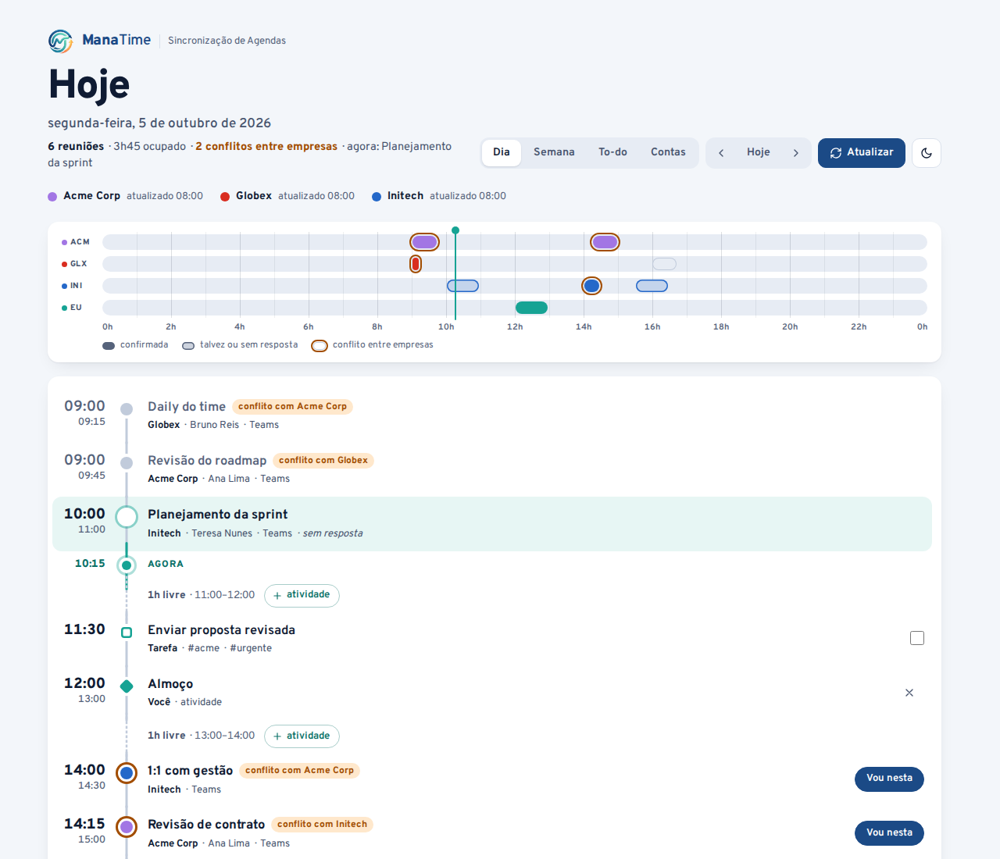
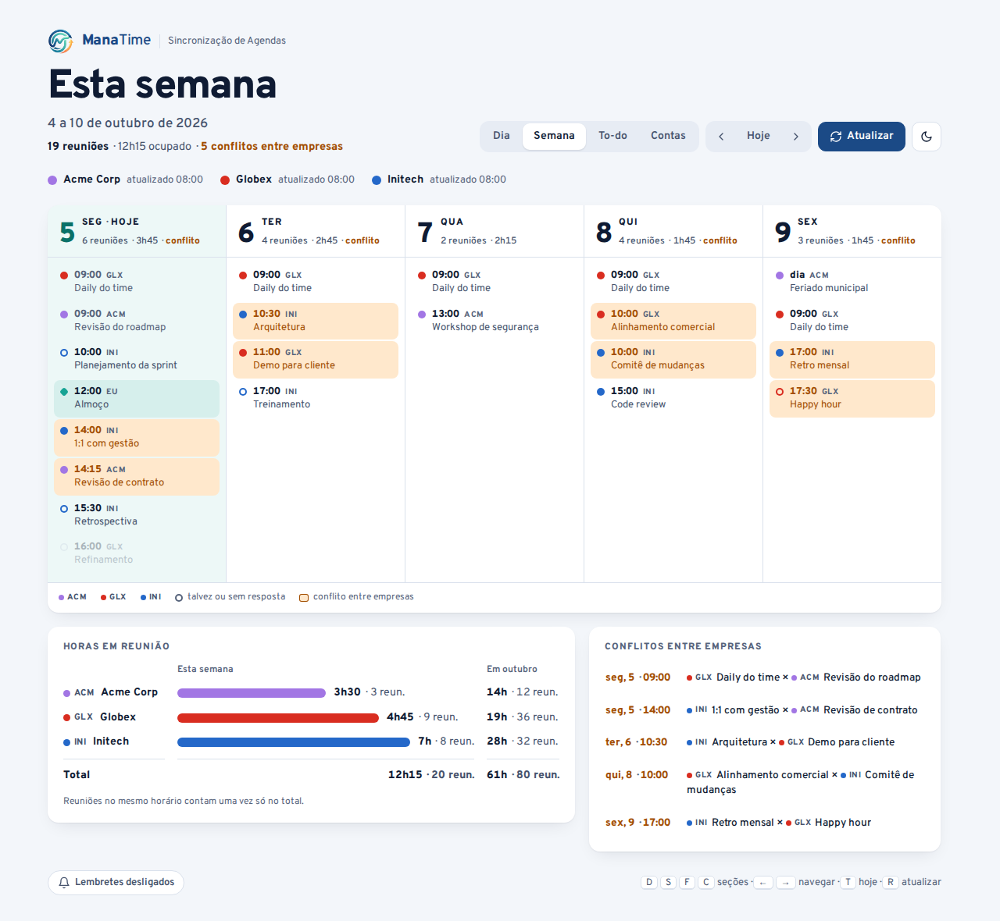
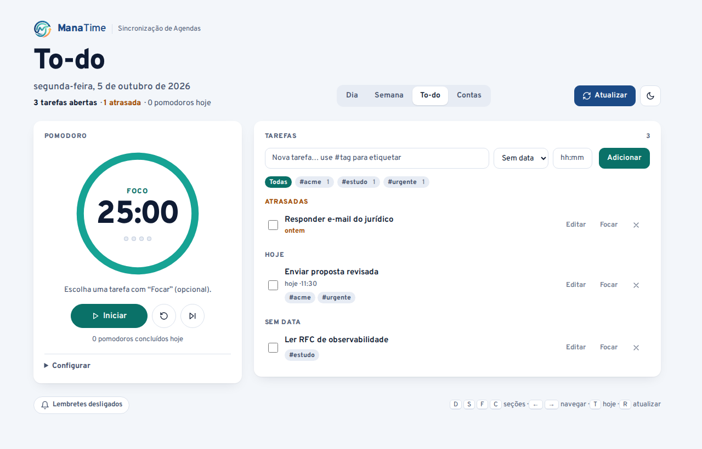
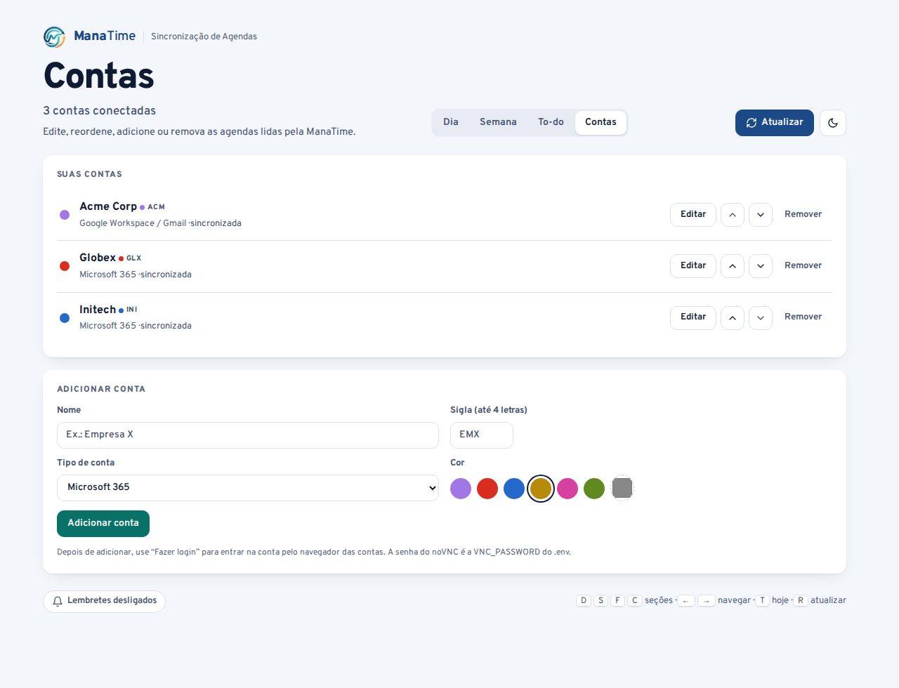
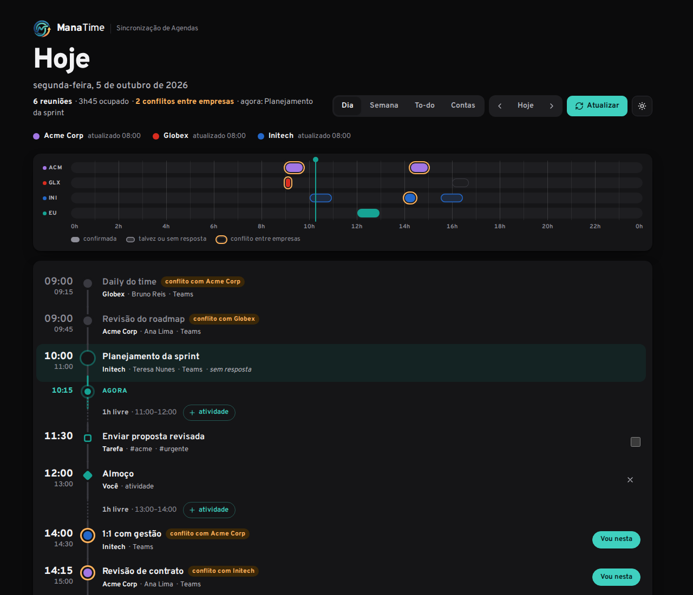
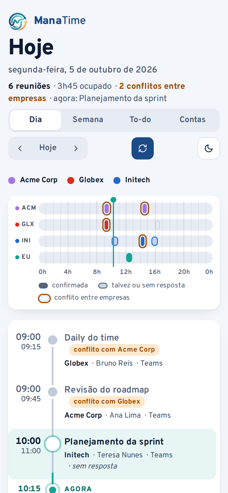

# ManaTime

**Sincronização de Agendas.** Junta as reuniões de várias contas de trabalho (Google Workspace,
Microsoft 365, Outlook pessoal) num único painel: o dia como uma linha do tempo, a semana em
colunas, horas por empresa, conflitos entre empresas, um to-do com pomodoro e a gestão das contas.

Tudo roda num container Docker na sua máquina. Não usa API de calendário nem chave de serviço:
cada conta tem um Chromium com login salvo, e um agente lê a agenda direto da página.



| Semana | To-do e pomodoro |
|---|---|
|  |  |

| Contas | Tema preto | Celular |
|---|---|---|
|  |  |  |

*As capturas usam empresas e reuniões fictícias.*

---

## Sumário

- [O que ele faz](#o-que-ele-faz)
- [Como funciona](#como-funciona)
- [Instalação](#instalação)
- [Primeiro uso](#primeiro-uso)
- [Uso](#uso)
- [Configuração](#configuração)
- [Dados e privacidade](#dados-e-privacidade)
- [Desenvolvimento](#desenvolvimento)
- [Limitações conhecidas](#limitações-conhecidas)

Detalhes técnicos em [docs/arquitetura.md](docs/arquitetura.md).

## O que ele faz

**Dia**
- Linha do tempo de 00:00 a 00:00 com um trilho por empresa e a linha do "agora".
- Lista do dia como uma linha de metrô: cada reunião é uma estação na cor da empresa
  (cheia = confirmada, vazada = talvez ou sem resposta, anel laranja = conflito entre empresas).
- **Conflitos:** em reuniões que se sobrepõem, o botão **Vou nesta** mantém a escolhida e marca
  as outras como "você não vai". Elas saem das horas e dos conflitos. **Desfazer** devolve.
- **Tempo livre:** os buracos entre reuniões aparecem como "1h30 livre · 12:00–13:30", com
  **+ atividade** para reservar o horário para você (não pode cruzar uma reunião que você vai).
- Tarefas do to-do com horário aparecem no trilho e podem ser concluídas ali mesmo.

**Semana**
- Calendário de segunda a sexta (sábado e domingo só se tiverem algo); reuniões em que você não
  vai ficam transparentes.
- Horas em reunião por empresa na semana e no mês, com total que conta sobreposições uma vez só.
- Lista dos conflitos entre empresas; sobreposições dentro da mesma empresa ficam recolhidas.

**To-do**
- Tarefas com ou sem data e horário, agrupadas em Atrasadas, Hoje, Próximas e Sem data.
- **Tags** escritas na própria tarefa: `Revisar proposta #cliente #urgente`. Filtro por tag e
  edição de título e tags.
- **Pomodoro configurável:** foco, pausas curta e longa, ciclos até a pausa longa, início
  automático e som. Liga o timer a uma tarefa e conta os pomodoros dela. O tempo continua certo
  com a aba em segundo plano; se a etapa terminar com a aba fechada, ele avisa ao reabrir.

**Contas**
- Adicionar, editar (nome, sigla, cor), reordenar e remover contas pelo próprio painel.
- Status de cada conta e botão **Fazer login** quando a sessão precisa ser renovada.

**Geral**
- Tema claro (padrão) e tema preto, lembrado entre visitas.
- Lembretes 5 minutos antes de cada reunião, por notificação do navegador.
- Atalhos: <kbd>D</kbd> dia, <kbd>S</kbd> semana, <kbd>F</kbd> to-do, <kbd>C</kbd> contas,
  <kbd>←</kbd> <kbd>→</kbd> navegar, <kbd>T</kbd> hoje, <kbd>R</kbd> atualizar.

## Como funciona

```
┌──────────────────────────── container ────────────────────────────┐
│ Xvnc :99 ── Chromium (conta A)  ┐                                  │
│          ── Chromium (conta B)  ├─ Playwright ─ FastAPI ─ painel :80  
│          ── Chromium (conta C)  ┘                  │               │
│ noVNC :6080 (login manual)                 data/cache, plan.json  │
└────────────────────────────────────────────────────────────────────┘
```

- Cada conta tem um perfil persistente do Chromium em `data/profiles/<id>`. Você faz o login uma
  vez pelo noVNC (inclusive MFA) e a sessão fica salva.
- **Microsoft 365 / Outlook:** o agente captura o JSON de eventos que o próprio Outlook baixa
  (`GetCalendarView`) e troca o intervalo pedido pelo período que quer ler.
- **Google:** o agente lê a descrição de acessibilidade de cada evento na visão da semana e confere
  com o total que o Google anuncia, para avisar se algum evento não foi lido.
- Os navegadores só ficam abertos durante a leitura (cerca de 250 MB de memória parado).
- A semana atual é relida a cada 15 minutos em dias úteis, das 7h às 20h; o mês inteiro, uma vez
  por hora.

## Instalação

Requisitos: Docker com Compose.

```bash
git clone https://github.com/newe-x/manatime.git
cd manatime
cp .env.example .env            # troque a VNC_PASSWORD
docker compose up -d --build
```

O painel fica em **http://localhost** (porta 80) e o navegador das contas (noVNC) em
**http://localhost:6080**. As duas portas só escutam em `127.0.0.1`. Se a porta 80 já estiver
em uso, troque `AGENDA_PORT` no `.env`. O container se chama `manatime`
(`docker logs manatime`, `docker compose restart`).

## Primeiro uso

1. Abra a aba **Contas** e adicione suas agendas (nome, sigla, tipo e cor). Se preferir arquivo,
   copie `config/accounts.example.yaml` para `config/accounts.yaml`.
2. Em cada conta, clique em **Fazer login**. O noVNC abre com a janela daquela conta; entre
   normalmente e marque "manter conectado". A senha do noVNC é a `VNC_PASSWORD` do `.env`.
3. Volte ao painel e clique em **Atualizar**.

Pode fechar as janelas do Chromium no noVNC: elas reabrem sozinhas na próxima leitura.

## Uso

- **Escolher num conflito:** "Vou nesta" e "você não vai" ficam só na ManaTime. Nada é recusado
  no Google ou no Outlook e nenhum organizador recebe resposta.
- **Lembretes:** clique em "Lembretes desligados" no rodapé e permita as notificações. Funcionam
  enquanto a aba do painel estiver aberta (pode estar minimizada).
- **Sessão expirada:** a conta aparece em vermelho com **Fazer login**.
- **Diagnóstico:** `data/debug/<conta>.json` guarda o que foi lido na última atualização.

## Configuração

Variáveis do `.env` (veja `.env.example`):

| Variável | Padrão | |
|---|---|---|
| `VNC_PASSWORD` | — | senha do noVNC (obrigatória) |
| `AGENDA_PORT` | 80 | porta do painel no host |
| `NOVNC_PORT` | 6080 | porta do noVNC no host |
| `TZ` | America/Sao_Paulo | fuso das agendas |
| `REFRESH_MINUTES` | 15 | intervalo da atualização automática (`0` desliga) |
| `REFRESH_HOURS` | 7-20 | horas em que ela roda |
| `REFRESH_WEEKDAYS_ONLY` | true | não atualizar sozinho no fim de semana |
| `CACHE_DAYS` | 100 | dias de reuniões guardados |
| `BROWSER_IDLE_SECONDS` | 90 | tempo até fechar o Chromium de uma conta parada |

Contas ficam em `config/accounts.yaml` (editável pela aba Contas). Tipos: `google`, `outlook`
(Microsoft 365), `outlook_live` (Outlook pessoal) e `custom` (endereço com `{y}`, `{m}` e `{d}`).

## Dados e privacidade

| Caminho | Conteúdo | Sensível |
|---|---|---|
| `data/profiles/` | sessões do Chromium de cada conta | **sim: dá acesso às contas** |
| `data/cache/` | reuniões lidas, um arquivo por dia | sim |
| `data/plan.json` | escolhas de conflito, atividades e tarefas | sim |
| `data/debug/` | o que foi lido na última atualização | sim |
| `config/accounts.yaml` | nomes e cores das contas | moderado |

- Nada sai da sua máquina: não há serviço externo, telemetria nem chave de API.
- `data/`, `.env` e `config/accounts.yaml` estão no `.gitignore`. Não inclua `data/profiles` em
  backups na nuvem nem em sincronização.
- Não exponha as portas na rede: o noVNC dá acesso às contas logadas.
- Use a ManaTime só em contas em que a política de TI permite acesso automatizado ao calendário.

## Desenvolvimento

```bash
python -m venv .venv && . .venv/bin/activate
pip install -r requirements-dev.txt
playwright install chromium

pytest tests                      # servidor (leitor, plano, contas, totais) + interface
python docs/make_screenshots.py   # regera as capturas do README com dados fictícios
```

Os testes de interface (`tests/ui`) rodam contra uma API falsa (`tests/ui/fake_api.py`), sem Docker
e sem agendas reais.

```
app/
  main.py        API (FastAPI), leitura por intervalo, horas, atualização automática
  browser.py     Chromium por conta: login, leitura e fechamento quando parado
  parser.py      transforma o JSON do Outlook e as descrições do Google em eventos
  plan.py        escolhas de conflito, atividades e tarefas (data/plan.json)
  config.py      variáveis de ambiente e contas (config/accounts.yaml)
  static/        painel: index.html, app.css, app.js, fonte e logo
config/accounts.example.yaml
docs/            arquitetura e capturas
tests/           testes do servidor e da interface
```

## Limitações conhecidas

- A leitura depende do formato atual das páginas do Google e do Outlook. Se mudarem, ajuste
  `app/parser.py`. O painel mostra um aviso em vez de um "dia livre" falso.
- No Google, a visão da semana não informa o organizador nem o status de "talvez".
- Lembretes e o som do pomodoro dependem da aba do painel aberta.
- Políticas de acesso condicional (dispositivo gerenciado, por exemplo) podem barrar o login fora
  de máquinas corporativas.
- O container roda como root, então arquivos criados em `data/` e `config/` ficam com dono root.

## Licença

[MIT](LICENSE): use, modifique e distribua à vontade, inclusive comercialmente, mantendo o aviso de
copyright.

A fonte [Overpass](https://overpassfont.org/) segue a SIL Open Font License
(`app/static/fonts/OFL.txt`).
